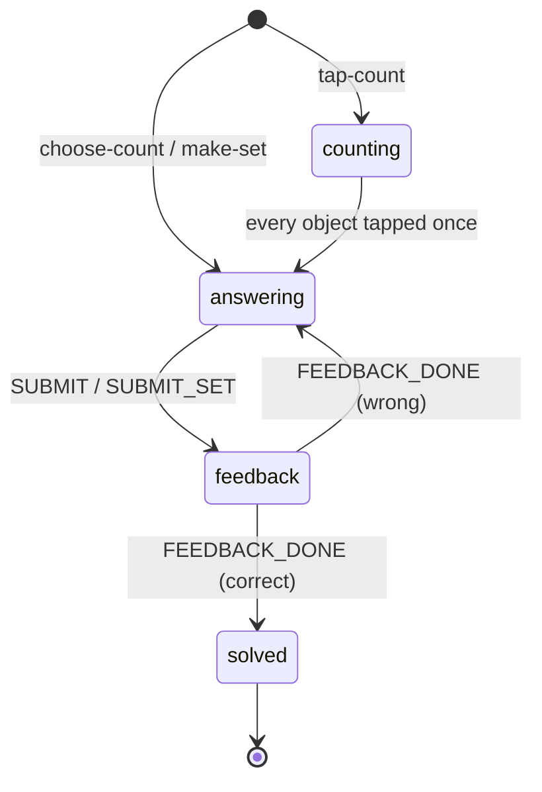

# Game Engine

Goal: add subjects, answer kinds and whole content libraries without rewriting the system. The engine separates these concerns:

| Concern | Module | Pure? |
|---|---|---|
| Exercise data | `src/games/<id>/definition.ts` | data |
| Procedural content | `src/games/<id>/generator.ts` + `src/engine/rng.ts` + `src/engine/round.ts` | yes |
| Content registry | `src/content/registry.ts` + `src/content/packs/<pack>/index.ts` | data |
| Validation logic | `src/engine/validation.ts` | yes |
| Session state | `src/engine/session.ts` (reducer) | yes |
| Feedback rules | `src/engine/feedback.ts` | yes |
| Progression rules | `src/engine/progression.ts` | yes |
| Audio events | `src/game/audioEvents.ts` (+ `AudioEngine`) | side-effects only |
| Animation states | `MascotState` (engine type) → `characters.css` | view |
| Game rendering | `src/game/boards.tsx`, `src/games/<id>/art.tsx` | view |
| Orchestration & timing | `src/game/GameRunner.tsx` | glue |

## Exercise schema (`Exercise` in `types.ts`)
`id, skillId, objective, ages, difficulty (= level + 1), interaction, answer, objectKind, poolSize?, layout?, seed, tutorial?, a11yDescription, params?, prompt?`. Authoring rules are enforced by `lintExercise` (unit-tested over all authored and generated data). Public API: `src/engine/index.ts`.

### Answers (D-023)
`answer` is a discriminated union, so the correct answer and its options are DATA and one validator serves every game:
`number { value, choices? }` · `choice { correct, options }` · `sequence { order, pieces }` · `set { correct, options }` · `match { pairs, items, targets }` · `numeric { value, tolerance, unit?, min?, max?, step? }`.
Boards submit one event, `SUBMIT { value }` (number · option id · ordered ids · selected ids · item→target map · number). `isSubmittable` drops malformed values (no-op, never "wrong"); `validateAnswer` returns `{ correct, reason, parts? }` where `parts` marks each slot/option/item right or wrong. Helpers for number boards: `targetOf`, `choicesOf`, `asNumber`. Default boards for `choice`/`set`/`sequence` live in `src/game/answer-boards.tsx`; `match`/`numeric` need a game board.

## Exercise state machine

Events: `TAP_OBJECT, SUBMIT, ADD_TO_BASKET, REMOVE_FROM_BASKET, SUBMIT_SET, FEEDBACK_DONE` (`CHOOSE` = deprecated alias of `SUBMIT` for numbers). Invalid events return the same state object (no-op), which the audio layer uses to play a soft "already counted" tap.
State exposed to boards: `hintStage` (0 none · 1 nudged · 2 modelled), `eliminated` (keys that can't be submitted), `model` (correct value at stage 2), `lastAnswer`, `check` (last validation incl. `parts`), `activeHints`, `feedback`.

## Feedback ladder
| Attempt | tap-count | choose-count | make-set | choose: number / choice | choose: sequence / set | choose: match | choose: numeric, free number |
|---|---|---|---|---|---|---|---|
| 1st wrong | eliminate choice + pulse last badge ("the last number tells how many") | eliminate choice + count-along | too many / too few / empty hint | eliminate the wrong pick (helper explains the idea) | mark-parts + eliminate first wrong/distractor | mark-parts | direction (too high / too low) |
| 2nd wrong | model answer: count-along + pulse correct choice, others disabled | same | + show target slots | model-answer + count-along (worked example) | same, `model` = order / set | same, `model` = pairs | same, `model` = value |
| 3rd+ wrong | same | same | basket set to target, counted aloud | same | same | same | same |
| correct | celebrate; praise names the number and the process | same | same | process praise (`correct.*` for numbers, `praise.*` otherwise; games override) | | | |
The child always makes the final submission (errorless), and retries are unlimited.

## Levels, rounds and progression (deterministic)
- A game declares `progression.maxLevel`; levels are 0..maxLevel (shown as Level 1..maxLevel+1) and exercise difficulty is `level + 1`. Static games use maxLevel 3 (difficulty 1–4); generators may use any size (counting: 0..7).
- `buildRound(game, { level, seed })` returns the round's pool: authored exercises (tutorials only at level 0) plus, for generator games, `roundLength` exercises for every difficulty the round can reach (1 .. level+1 + ⌈(roundLength−1)/stepUpAfter⌉). Each generated item gets its own RNG `createRng(hashSeed(seed, gameId, level, index))`, so bands are independent and a saved `{ level, seed }` rebuilds the round exactly (resume). Free play uses a random seed per round; daily learning passes `seedForDay(day, …)`.
- R0 level-up (`levelAfterRound`): ≥ 50 % first-try in a round → level + 1 (capped at maxLevel); otherwise replay the level (D-019) · R1 level 0 starts with the tutorial · R2 2 consecutive first-try → difficulty +1 (max maxLevel+1) · R3 ≥ 3 attempts → −1 (min 1) · R4 2nd-try success resets the streak · R5 next = unplayed at the current difficulty, preferring a different interaction/answer kind than last, then the kind used least this round, then pool order; else nearest difficulty (lower first) · R6 round = 8 exercises.
- Covered by `tests/unit/progression.test.ts` (fixture pool, simulated fast/average/struggling learners) and `tests/unit/generator.test.ts` (determinism, lint over levels × 50 seeds, band coverage, every round offers all interactions).

## Content registry (`src/content`)
Packs in `src/content/packs/<pack>/index.ts` (default export `ContentPack`) declare subjects, topics, skills (with prerequisites), characters and worlds; `import.meta.glob` collects them, so a new library is a new folder. A `World` carries the game id, subject/topic, skills, ages, maxLevel, title, gameType, kid blurb, parent/SEO description, character ids, lazy `load` (component) and `loadDefinition` (data), voice glob and optional map position. `App.tsx` routes `/play/<id>` via `getWorld`; the map lists worlds with a `map` position. Helpers: `getWorld, allWorlds, worldsForAge, worldsBySubject, skillPrereqs, getSkill, checkRegistry`. `tests/unit/registry.test.ts` asserts integrity (unique ids, known references, acyclic prerequisites, every world loads and lints at every level).

## Runtime sequence (correct answer)

Async presentation sequences carry a token; any newer sequence or unmount invalidates older ones, so a child can never be left in a stale state.

## Layout guarantee
`src/game/layout.ts` places objects in jittered grid cells sized from the play field's measured aspect ratio; objects are ≤78 % of a cell with ≤15 % jitter, so they cannot overlap (property-tested over counts 1–10 × 7 aspects × 39 seeds).

## Stories, helpers, music (milestone 2)
`GameSkin` optionally provides `story { intro, outro, between }` (cinematic `StoryBeat`s played by `StoryPlayer`: scene + camera move + sfx + voiced subtitle; tap to advance, skip anytime, time-capped), `helper` (a second character that slides in to explain the concept at the start of a round and on a first miss), `music` (looping world track, ducked under speech), custom `Board`/`Tray`, game-specific `praise`/`hintVoice`, and worked-example steps (`alongSteps`/`alongSay`). Contract: `docs/GAME_AUTHORING.md`.

## Adding things
- **New world:** a game folder + a registry entry in a pack (`docs/GAME_AUTHORING.md`). No engine, app or map edits.
- **New answer kind:** extend `Answer` → `isSubmittable`/`validateAnswer`/`correctValue`/keys → feedback branch → lint → default board (optional) → unit tests (validation + ladder). The runner, progression, persistence and audio layers stay unchanged.
- **New subject/library:** a new pack folder with its subjects, topics, skills and worlds, plus skills in CURRICULUM.md and voice lines.
