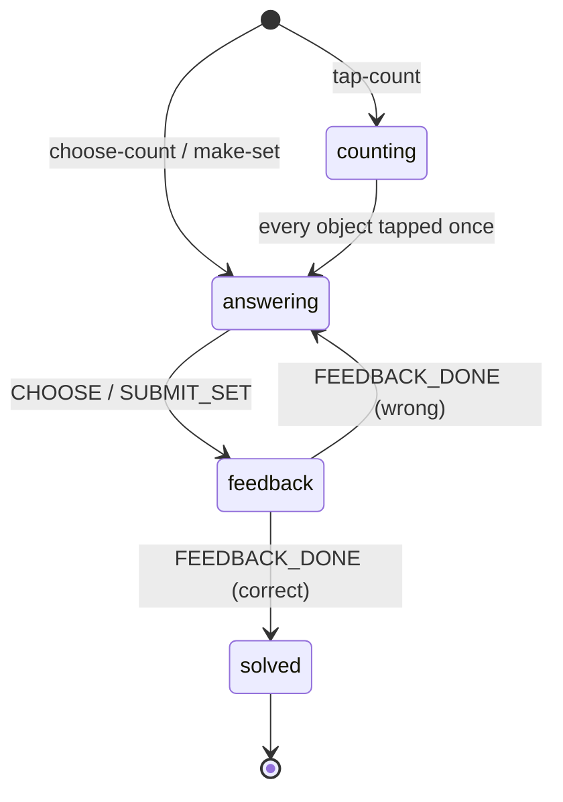
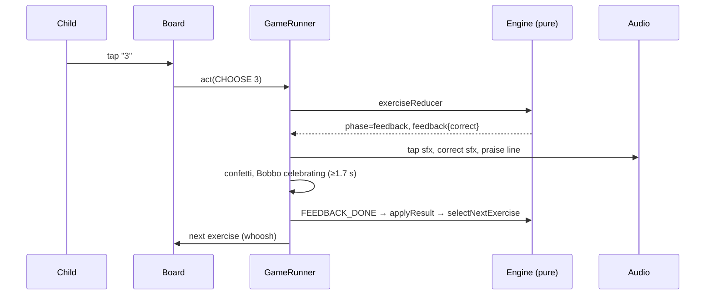

# Game Engine

Goal: add subjects and interaction types without rewriting the system. The engine separates eight concerns:

| Concern | Module | Pure? |
|---|---|---|
| Exercise data | `src/games/<id>/definition.ts` | data |
| Validation logic | `src/engine/validation.ts` | yes |
| Session state | `src/engine/session.ts` (reducer) | yes |
| Feedback rules | `src/engine/feedback.ts` | yes |
| Progression rules | `src/engine/progression.ts` | yes |
| Audio events | `src/game/audioEvents.ts` (+ `AudioEngine`) | side-effects only |
| Animation states | `MascotState` (engine type) → `characters.css` | view |
| Game rendering | `src/game/boards.tsx`, `src/games/<id>/art.tsx` | view |
| Orchestration & timing | `src/game/GameRunner.tsx` | glue |

## Exercise schema (`Exercise` in `types.ts`)
`id, skillId, objective, ages, difficulty (1–4), interaction, target, objectKind, choices?, poolSize?, layout?, seed, tutorial?, a11yDescription`. Authoring rules are enforced by `lintExercise` (unit-tested over all data).

## Exercise state machine

Events: `TAP_OBJECT, CHOOSE, ADD_TO_BASKET, REMOVE_FROM_BASKET, SUBMIT_SET, FEEDBACK_DONE`. Invalid events return the same state object (no-op), which the audio layer uses to play a soft "already counted" tap.

## Feedback ladder
| Attempt | tap-count | choose-count | make-set |
|---|---|---|---|
| 1st wrong | eliminate choice + pulse last badge ("the last number tells how many") | eliminate choice + count-along | too many / too few / empty hint |
| 2nd+ wrong | model answer: count-along + pulse correct choice, others disabled | same | + show target slots in basket |
| correct | celebrate; praise names the number and the process | same | same |

## Progression (deterministic)
R1 start at difficulty 1 with the tutorial · R2 2 consecutive first-try → +1 level (max 4) · R3 ≥3 attempts → −1 level (min 1) · R4 2nd-try success resets streak · R5 next = first unplayed at current level with a different interaction than last; else nearest level (lower first) · R6 round = 8 exercises. All covered in `tests/unit/progression.test.ts` (including simulated fast, average and struggling learners).

## Runtime sequence (correct answer)

Async presentation sequences carry a token; any newer sequence or unmount invalidates older ones, so a child can never be left in a stale state.

## Layout guarantee
`src/game/layout.ts` places objects in jittered grid cells sized from the play field's measured aspect ratio; objects are ≤78 % of a cell with ≤15 % jitter, so they cannot overlap (property-tested over counts 1–10 × 7 aspects × 39 seeds).

## Adding things
- **New game, same interactions:** new folder with `definition.ts`, `art.tsx`, skin file; register a route. No engine changes.
- **New interaction type** (e.g. number line, matching): extend `InteractionType` → validator → feedback branch → reducer events → board → audio events → unit tests → e2e helper. The runner, progression, persistence and audio layers stay unchanged.
- **New subject:** same as above plus skills in CURRICULUM.md and voice lines.
