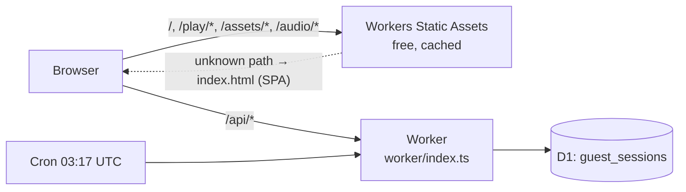
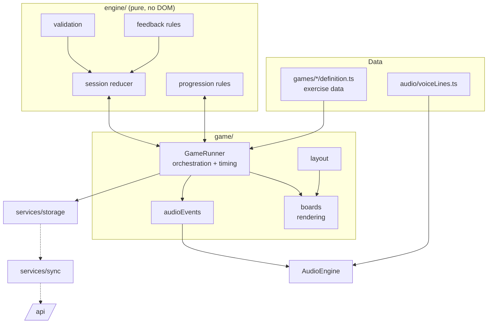

# Technical Architecture

Validated against official Cloudflare docs on 2026-11-17 — full notes with source links: [research/CLOUDFLARE_NOTES.md](research/CLOUDFLARE_NOTES.md).

## Stack (versions installed)
React 19.3 · TypeScript 5.9 (strict; TS 7 native was available but skipped for tooling maturity) · Vite 8.3 · `@cloudflare/vite-plugin` 1.69 (stable v1; v2 + `cf` CLI are beta) · Wrangler 4.163 · D1 · Vitest 5 · Playwright 1.63. Fonts self-hosted via Fontsource (Baloo 2, Nunito; OFL) — no external font requests.

## Runtime topology

- `assets.run_worker_first: ["/api/*"]` — only API calls invoke (and bill) the Worker. Navigations use `not_found_handling: "single-page-application"`.
- Client works fully offline from the API: progress lives in `localStorage`. D1 sync (`services/sync.ts`) is implemented and tested but **switched off** until a restore path exists (D-011).
- R2 is **not used yet**: all media is small and built into static assets (11 SFX = 168 KB). Use R2 when a media catalogue changes without deploys or files exceed 25 MiB.

## Client architecture

Game-specific code is only `definition.ts` (data), `art.tsx` (SVG) and a 15-line skin file. A new counting-style game needs no engine changes; a new interaction type follows the checklist in `.claude/agents/game-engineer.md`.

Code splitting: the game (engine + art + runner) is a lazy chunk; home/menus load first.

## API
| Method | Path | Body | Notes |
|---|---|---|---|
| GET | /api/health | – | `{ok, env}` |
| POST | /api/guest | – | creates random UUID row, 201 |
| GET | /api/guest/:id/progress | – | 404 if unknown |
| PUT | /api/guest/:id/progress | GuestProgress JSON ≤ 8 KB | strict schema (`progressSchema.ts`, shared client/Worker); unknown keys rejected |
| DELETE | /api/guest/:id | – | parent "delete progress" |
Controls: same-origin check on writes (Origin header), UUID-format ids (122-bit random = bearer secret for anonymous, non-sensitive data), `no-store`, `nosniff`, generic errors, parameterised D1 statements. Known gap: no rate limiting yet (see PRIVACY_SECURITY.md).

### Worker structure (Phase 1)
`worker/index.ts` (fetch + scheduled) → `worker/router.ts` (path params, 404/405, Origin check on writes) → `worker/routes/*.ts`, registered one line each in `worker/routes/index.ts` (add `export { routes as push } from "./push";`). Helpers in `worker/lib/` (http, validation, crypto, session, rateLimit, email + templates, entitlements, config). Scheduled jobs in `worker/jobs/`: `CRON_JOBS` maps each cron in `wrangler.jsonc` to named jobs (`purge`, `daily-digest`). Data contracts shared with the client live in `src/account/` (schema, merge, points, catalog). Database choice and free-tier limits: [DATABASE.md](DATABASE.md).

### Account API (session cookie required unless noted)
| Method | Path | Notes |
|---|---|---|
| POST | /api/auth/magic-link | `{email, mode: "signup"\|"signin", consent}`; signup needs `consent: true`; 202; dev returns `devLink` |
| GET / POST | /api/auth/verify | GET shows a confirm page (never consumes); POST (form `token`) consumes, sets cookie, 303 → /parents |
| POST | /api/auth/logout | deletes session |
| GET / PUT / DELETE | /api/me | profile + children + entitlement; `{digestOptIn}`; delete needs `{confirm:"delete"}` |
| GET | /api/me/export | JSON download |
| GET / POST | /api/children | list; create `{monster, ageBand, publicName?, nickname?, progress?}` (max 4 → 409). The child-typed monster name is never accepted; `publicName` must be a pick-list combination (`src/account/publicName.ts`), default derived from the child id |
| PUT / DELETE | /api/children/:id | `{publicName?, monster?, ageBand?, nickname?: string\|null}` |
| GET / PUT | /api/children/:id/settings | see contract below |
| GET | /api/children/:id/progress | ChildProgress |
| POST | /api/children/:id/sync | `{progress: ChildProgress}` → server merges (src/account/merge.ts) → `{progress, settings}` |
| POST | /api/children/:id/invites | `{code, link, expiresAt}` single use, 7 days |
| GET / POST | /api/invites/:code(/accept) | peek (monster only) / accept `{childId}` |
| GET | /api/children/:id/friends · /leaderboard?today=YYYY-MM-DD · /challenges | friends-only |
| POST / DELETE | /api/friendships/:id/approve · /api/friendships/:id | either side's parent |
| POST / GET | /api/challenges · /api/challenges/:token · /api/challenges/:token/result | friends-only; `{childId, worldId, level, seed, score}` |
| GET / POST | /api/unsubscribe?p=&s= | no session; HMAC-signed; POST is RFC 8058 one-click (cross-origin allowed) |
| POST / GET | /api/parent-signup(/verify) | legacy onboarding contract, now creates a `parents` row |

### Contract: per-child settings (for the daily-learning feature)
```
GET  /api/children/:id/settings  → 200 { "settings": { "dailyLimit": 5, "sound": true, "music": true } }
PUT  /api/children/:id/settings  body: any subset of { "dailyLimit": int 3–10, "sound": bool, "music": bool }
                                 → 200 { "settings": <full merged settings> } · 400 invalid_body (unknown key, out of range)
                                 · 401 not signed in · 404 not this parent's child
```
Defaults: `dailyLimit` 5, `sound` true, `music` true (`DEFAULT_SETTINGS` in `src/account/schema.ts`; validate with `parseSettings`). On a device linked to a child, the latest settings are cached offline in `loadState().account.settings` (refreshed after every sync and whenever the parent changes them on that device); unlinked/guest devices have `account === null` → use the defaults. The game must never wait on this API.

### Contract: challenge round (for the game runtime)
When `loadState().challenge` is set and its `gameId` matches the game being opened, the runtime **should** start the round at `challenge.level` and seed exercise selection with `challenge.seed` so both children get the same round. Not wired yet (GameRunner is outside this agent's files): today the round uses the child's own level and normal selection; the score is still recorded. Round results are derived in `services/storage.ts` from the runtime's existing `saveState` calls (`deriveRoundRecord`); a direct `recordRound()` call from GameRunner would be cleaner later.

## Data model
`migrations/0001_guest_sessions.sql`: `guest_sessions(id TEXT PK, created_at, updated_at, progress_json)` + index on `updated_at` for the retention purge (180 days, daily cron). `0003_accounts.sql`: parents, auth_tokens, sessions, children, friend_invites, friendships, challenges, challenge_results, rate_limits (supersedes `parent_signups`; verified rows migrated).

## Environments
| Env | How | Data |
|---|---|---|
| Local | `cp .dev.vars.example .dev.vars` once (sets `APP_ENV=development`; the `wrangler.jsonc` top level is `production`), then `npm run dev` (Worker + D1 in workerd; state in `.wrangler/`). Development behaviour also requires a localhost request (`worker/lib/config.ts`) | local SQLite |
| Preview | `wrangler versions upload --preview-alias <name>`; `preview_urls: false` keeps workers.dev previews off until Access protects them | staging DB |
| Staging | `CLOUDFLARE_ENV=staging vite build && wrangler deploy` (env chosen at build time with the Vite plugin) | `brainzippy-db-staging` |
| Production | `CLOUDFLARE_ENV=production` build + `wrangler deploy` (manual workflow) — **requires owner approval**. An unset `CLOUDFLARE_ENV` falls back to the production-safe top level; an unknown name is an error (docs/DEPLOY.md) | `brainzippy-db` |

Config hardening: `workers_dev: false`, `preview_urls: false`, invocation logs off, no `nodejs_compat` (unused), compatibility date 2026-11-01.

Placeholders: both `database_id` values in `wrangler.jsonc` are zero UUIDs; replace after `wrangler d1 create`. Secrets (`wrangler secret put`, `.dev.vars` locally): `RESEND_API_KEY`, `SIGNING_SECRET` (≥32 random bytes). Vars: `EMAIL_FROM`, `APP_ORIGIN` (https origin for emailed links), `DIGEST_BATCH`. Local development needs none (magic links are logged and shown on screen), but only with `APP_ENV=development` from `.dev.vars` and a localhost request.

## Caching
`public/_headers`: `/assets/*` (hashed) `max-age=31536000, immutable`; `/audio/*` 7 days; HTML default (revalidate). Worker responses set their own headers (`_headers` doesn't apply to them).

## CI/CD
`.github/workflows/ci.yml`: typecheck → unit → Playwright (all projects). Deployment is deliberately manual until credentials and approval exist; the staging job template uses `cloudflare/wrangler-action@v4` with a scoped API token secret.

## Cost assumptions
At launch traffic everything fits the **Free** plan: static asset requests are free and unlimited; only `/api/*` counts toward 100k Worker requests/day; each round costs ~2 API calls and 1–2 D1 row writes (100k writes/day free). Usage-billed items to watch: Worker requests beyond free tier, D1 writes, future R2 storage/ops, Workers Builds minutes. Paid plan: $5/month minimum. Details and sources: research/CLOUDFLARE_NOTES.md §8.

## Verification status (milestone 1)
| Check | Status |
|---|---|
| Local dev works (Worker + D1) | Verified (`curl /api/health`, `POST /api/guest`) |
| Builds for Cloudflare | Verified (`vite build` → `dist/client` + `dist/brainzippy`) |
| Migrations reproducible | Verified locally (`wrangler d1 migrations apply --local`); remote not run (no account credentials) |
| Secrets outside source control | Verified (`.gitignore`; no secrets exist yet) |
| Static assets cached | Configured via `_headers`; header behaviour on Cloudflare edge **not verified** (no deploy) |
| API validation/access control | Verified by unit + e2e API tests |
| Preview environments | Configured, **not verified** (no account) |
| Automated deployment | CI template only; **not configured** (needs token + approval) |
